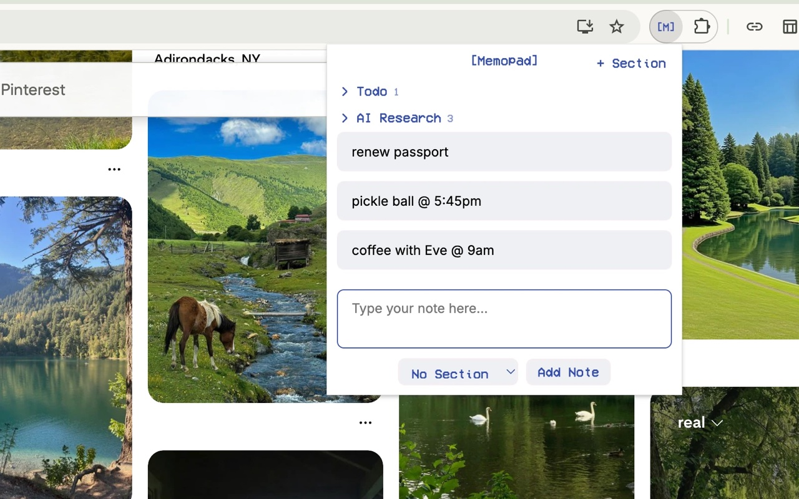

# Memopad

A seamless, minimalistic tool for capturing tasks and ideas.

[Add to Chrome](https://chromewebstore.google.com/detail/memopad/omcpfoipabmmcjpooadjcioiejenaopa)



## Features

- **Save from any page.** Select text, right-click, *Save to Memopad*.
- **Sections, if you want them.**
- **Find anything** with ⌘F (Ctrl+F).

Everything stays on your device.

## Develop

There's no build step and no dependencies. To run it:

1. Open `chrome://extensions` and turn on **Developer mode**.
2. Click **Load unpacked** and choose this folder.
3. After a change, click the reload arrow on Memopad's card.

```bash
npm test          # unit tests
npm run package   # zip for the Chrome Web Store
```

| Path | What's there |
|---|---|
| `src/popup/` | The popup: `popup.html`, `popup.css`, `popup.js` |
| `src/background.js` | The right-click menu |
| `src/lib/store.js` | Saving notes, saving from pages, and the 1.x migration |
| `src/lib/search.js` | Keyword search |
| `src/lib/links.js` | Finding web addresses in a note |
| `test/` | Unit tests for `src/lib/` |

## Contributing

Contributions are welcome. Memopad stays small on purpose, so:

- Open an issue before a big change, so we can agree on it first.
- Keep each pull request to one change, with tests for anything in `src/lib/`.
- No dependencies, no build step, no network requests.
- Keep the look: the same colours, fonts and popup size.

Run `npm test` before opening a pull request. CI runs it too. By contributing, you agree to share your changes under the same license as Memopad.

## License

Copyright © 2025–2026 Nancy Patel.

Memopad is free software under the [GNU General Public License v3.0](LICENSE). You can use, study, change and share it. If you share a changed version, it has to stay under the same license, with its source code available.

The Memopad name and icon aren't covered by the license. Please don't use them for your own version.

The bundled fonts keep their own licenses; see [THIRD_PARTY_NOTICES.md](THIRD_PARTY_NOTICES.md).
